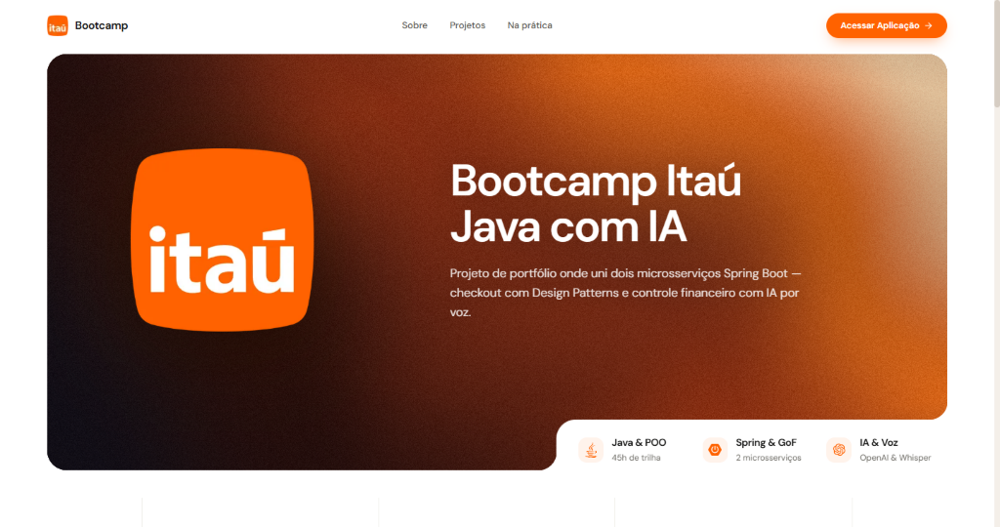
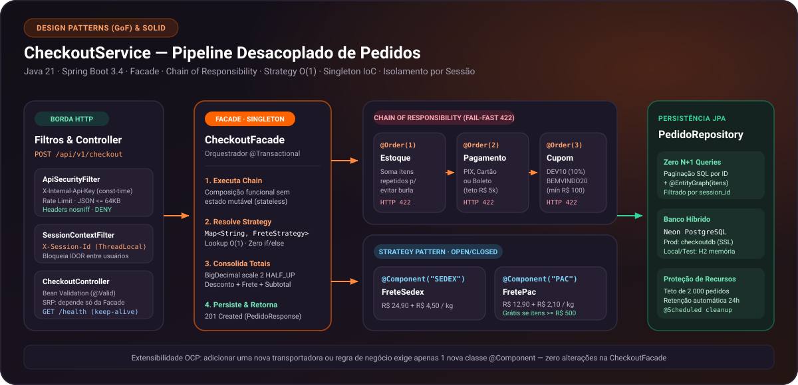

<div align="center">

# CheckoutService — API REST de Checkout (Design Patterns GoF & SOLID)

**Microsserviço Java 21 / Spring Boot 3 projetado para eliminar "God Classes" de checkout utilizando Facade, Chain of Responsibility, Strategy e Singleton com segurança de produção, isolamento por sessão e banco híbrido (Neon PostgreSQL / H2).**

[](https://openjdk.org/)
[](https://spring.io/projects/spring-boot)
[](https://neon.tech/)
[](https://www.docker.com/)
[](#testes-automatizados)

<br />



</div>

> Este microsserviço integra o ecossistema do **Bootcamp Java & IA (Itaú + DIO)**, consumido server-side pelo portal BFF **[ItauBootcamp](https://github.com/GabrielVSL/ItauBootcamp)** em conjunto com o **[Finance-AI-Service](https://github.com/GabrielVSL/Finance-AI-Service)**.

---

## Arquitetura e Fluxo dos Design Patterns

<p align="center">
  
</p>

### Por que escolhi esta arquitetura?

Em sistemas de e-commerce sem fronteiras claras, o serviço de checkout rapidamente vira uma *God Class* repleta de `if/else` para transportadoras, regras de estoque misturadas ao controller e código difícil de testar ou estender. Este serviço resolve o problema aplicando **4 padrões GoF** apoiados diretamente pelo container IoC do Spring:

| Padrão GoF | Implementação no Projeto | Por que foi feito assim? |
| :--- | :--- | :--- |
| **Facade** | [`CheckoutFacade`](src/main/java/br/com/devlopes/checkout/facade/CheckoutFacade.java) | O [`CheckoutController`](src/main/java/br/com/devlopes/checkout/controller/CheckoutController.java) depende exclusivamente da Facade (SRP). Ele desconhece elos de validação, estratégias de frete, cupons ou JPA — apenas valida o DTO HTTP e delega. |
| **Chain of Responsibility** | [`ValidacaoPedidoHandler`](src/main/java/br/com/devlopes/checkout/chain/ValidacaoPedidoHandler.java) + 3 elos com `@Order` | Em vez de mutar ponteiros `setNext(...)` em beans Singleton (o que quebraria thread-safety sob concorrência), a interface é `@FunctionalInterface` e a cadeia é composta funcionalmente no construtor via `reduce(ValidacaoPedidoHandler::encadear)` usando `@Order(1..3)`. Comportamento **fail-fast** (`422 Unprocessable Entity`). |
| **Strategy** | [`FreteStrategy`](src/main/java/br/com/devlopes/checkout/strategy/FreteStrategy.java), [`FreteSedex`](src/main/java/br/com/devlopes/checkout/strategy/FreteSedex.java), [`FretePac`](src/main/java/br/com/devlopes/checkout/strategy/FretePac.java) | O Spring injeta todos os beans em `Map<String, FreteStrategy>` indexados pelo nome do bean (`"SEDEX"`, `"PAC"`). A resolução ocorre em **O(1)** sem nenhum `if/else` ou `switch`. Adicionar uma nova transportadora exige apenas criar uma nova classe `@Component("JADLOG")` (princípio **Open/Closed**). |
| **Singleton (IoC)** | Beans `@Service`, `@Component`, `@Repository` | Todas as instâncias de negócio são **stateless** (zero estado mutável compartilhado), tornando o escopo Singleton do Spring 100% seguro em ambientes multi-thread. |

---

## Desafios Reais Encontrados e Soluções de Engenharia

Durante a auditoria de qualidade e preparação para deploy público (Render + Neon PostgreSQL), vários pontos sutis foram identificados e corrigidos:

1. **Burla de estoque por itens duplicados no mesmo carrinho**
   - **Problema:** Validar cada linha do carrinho isoladamente permitia enviar o mesmo `PROD-LIMITADO` (estoque = 3) em duas linhas com `quantidade: 2` cada (total 4), passando pela regra.
   - **Solução:** [`ValidacaoEstoqueHandler`](src/main/java/br/com/devlopes/checkout/chain/ValidacaoEstoqueHandler.java) agora agrega todas as quantidades por `produtoId` normalizado (`Map.merge(..., Math::addExact)`) antes de verificar o saldo disponível.

2. **Divergência contábil de arredondamento (`BigDecimal`)**
   - **Problema:** `ItemCheckoutRequest.calcularSubtotal()` multiplicava antes de arredondar o preço unitário, enquanto a entidade `ItemPedido` arredondava `precoUnitario` antes de multiplicar — podendo gerar `valorItens` diferente da soma dos subtotais persistidos (ex.: `10.004 × 3`).
   - **Solução:** Escala padronizada (`setScale(2, RoundingMode.HALF_UP)`) antes da multiplicação em [`ItemCheckoutRequest`](src/main/java/br/com/devlopes/checkout/dto/ItemCheckoutRequest.java), garantida por teste unitário dedicado.

3. **Eliminação de N+1 Queries e Paginação em Memória do Hibernate**
   - **Problema:** `findAll()` disparava 1 query para pedidos + N queries lazy para `itens`, e combinar `Pageable` diretamente com `@EntityGraph` em coleção `@OneToMany` fazia o Hibernate paginar em memória (`HHH90003004`).
   - **Solução:** Consulta em 2 etapas no [`PedidoRepository`](src/main/java/br/com/devlopes/checkout/repository/PedidoRepository.java): primeiro busca apenas os IDs mais recentes da sessão com `LIMIT` real em SQL (`findRecentIdsBySessionId`), e depois carrega os pedidos com seus itens em um único `JOIN` via `@EntityGraph`.

4. **Proteção de PII, Anti-IDOR e Blindagem para Produção**
   - **Isolamento por sessão (`X-Session-Id`):** [`SessionContextFilter`](src/main/java/br/com/devlopes/checkout/config/SessionContextFilter.java) isola listagem e busca por ID (`findWithItensByIdAndSessionId`), impedindo que um visitante acesse pedidos ou e-mails de outro adivinhando IDs sequenciais.
   - **Autenticação interna & Rate Limit ([`ApiSecurityFilter`](src/main/java/br/com/devlopes/checkout/config/ApiSecurityFilter.java)):** validação de `X-Internal-Api-Key` em tempo constante (`MessageDigest.isEqual`), limite de corpo JSON (`64 KB`), rate limiting por IP, headers defensivos (`nosniff`, `DENY`, `no-store`) e endpoint leve `GET /health` fora do banco.
   - **Secure-by-default:** Console H2 (`H2_CONSOLE_ENABLED=false`, prevenindo RCE), Swagger (`SWAGGER_ENABLED=false`), `show-sql=false` e stack traces desabilitados por padrão.
   - **Gestão de memória em plano gratuito (512 MB RAM):** [`PedidoCleanupScheduler`](src/main/java/br/com/devlopes/checkout/facade/PedidoCleanupScheduler.java) remove pedidos expirados (`24h`), há teto de armazenamento (`MAX_STORED_ORDERS`) e o [`Dockerfile`](Dockerfile) multi-stage roda com usuário não-root e JVM ajustada (`-XX:MaxRAMPercentage=70.0 -XX:+UseSerialGC`).

---

## Endpoints e Regras de Negócio

| Método | Rota | Descrição |
| :---: | :--- | :--- |
| `GET` | `/health` | Health check leve (não consulta banco, liberado para monitoramento) |
| `POST` | `/api/v1/checkout` | Executa Chain -> Strategy -> Persistência e retorna `201 Created` |
| `GET` | `/api/v1/checkout/pedidos` | Lista os pedidos recentes da sessão atual (`X-Session-Id`) |
| `GET` | `/api/v1/checkout/pedidos/{id}` | Busca pedido por ID pertencente à sessão atual (`404` se de outra sessão) |

### Matriz de Regras e Cenários `422 Unprocessable Entity`

| Regra | Condição | Resultado |
| :--- | :--- | :--- |
| **Frete SEDEX** | `modalidadeFrete = "SEDEX"` | Taxa fixa `R$ 24,90` + `R$ 4,50/kg` |
| **Frete PAC** | `modalidadeFrete = "PAC"` | `R$ 12,90` + `R$ 2,10/kg` (**Grátis** se itens >= `R$ 500,00`) |
| **Frete inválido** | Qualquer modalidade não registrada no Strategy Map | `422` — Modalidade não suportada |
| **Estoque (Elo 1)** | `PROD-SEM-ESTOQUE` (0 un.) ou `PROD-LIMITADO` (> 3 un. somadas) | `422` — Estoque insuficiente |
| **Pagamento (Elo 2)** | Forma fora de `PIX`, `CARTAO_CREDITO`, `BOLETO`, ou boleto > `R$ 5.000,00` | `422` — Pagamento não permitido |
| **Cupom (Elo 3)** | `DEV10` (10% off) ou `BEMVINDO20` (20% off, mín. `R$ 100,00`) | `422` — Cupom inválido ou abaixo do mínimo |

---

## Como Executar Localmente e em Produção

### Localmente (H2 em memória — zero configuração)
```bash
git clone https://github.com/GabrielVSL/CheckoutService.git
cd CheckoutService

# Executar os 21 testes (unitários, integração, segurança e anti-IDOR)
mvn test

# Subir a API na porta padrão 8081
mvn spring-boot:run
```

> Para inspecionar Swagger ou H2 **apenas localmente**, inicie com `SWAGGER_ENABLED=true` e/ou `H2_CONSOLE_ENABLED=true`.

### Produção (Docker no Render + Neon PostgreSQL)
O projeto detecta o banco automaticamente: basta configurar as variáveis listadas em [`.env.example`](.env.example) no painel do Render (`Runtime: Docker`, `Health Check Path: /health`):
- `SPRING_DATASOURCE_URL=jdbc:postgresql://<host-neon>/checkoutdb?sslmode=require`
- `SPRING_DATASOURCE_USERNAME` / `SPRING_DATASOURCE_PASSWORD`
- `INTERNAL_API_KEY` *(mesmo valor configurado no BFF)* e `TRUST_PROXY_HEADERS=true`

---

## Testes Automatizados

A suíte conta com **21 testes** (JUnit 5, Mockito e MockMvc) cobrindo:
- [`CheckoutFacadeTest`](src/test/java/br/com/devlopes/checkout/CheckoutFacadeTest.java): cálculos SEDEX/PAC, frete grátis, falhas fail-fast em cada elo da Chain, bloqueio de burla de estoque duplicado e consistência de arredondamento.
- [`CheckoutControllerIntegrationTest`](src/test/java/br/com/devlopes/checkout/CheckoutControllerIntegrationTest.java): fluxo HTTP completo (`201`, `400`, `404`, `422`), `/health`, headers de segurança e **isolamento de sessão / anti-IDOR**.
- [`ApiSecurityFilterTest`](src/test/java/br/com/devlopes/checkout/config/ApiSecurityFilterTest.java): exigência de `X-Internal-Api-Key` em `/api/**`, liberação de `/health` e rate limiting (`429` + `Retry-After`).
